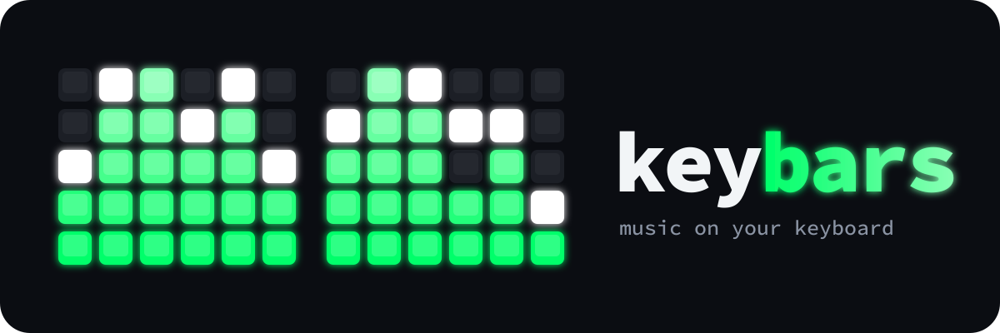

<p align="center"></p>

# keybars

A music equaliser on your keyboard's backlight. Whatever the computer plays, each column of keys becomes a bar rising from the bottom
row, bass on the left and treble on the right, with a white peak dot that
holds a moment and falls like a hi-fi meter.

- Sends only the keys that changed, so it keeps up with the music: about
  30 fps on a Moonlander.
- Drives keyboards through a small backend interface; today that is ZSA's
  Keymapp (Moonlander, Voyager), and other per-key RGB keyboards need only
  a backend and a map.
- Finds the connected keyboard on its own; any other board needs only a text
  map, which `keybars find` helps you write.
- When the music stops, the keys go back to your layout's colours; the same
  when keybars exits. (On ZSA boards, keys outside the bars are dark while it
  plays: once Keymapp drives any key, the firmware shows only what it sets.)
- The number row is left alone by default, free for other lights such as
  [herdr-zsa-lights](https://github.com/jwarykowski/herdr-zsa-lights)' agent
  status.

## Requirements

- A keyboard with a backend. Supported today: ZSA Moonlander and Voyager
  through [Keymapp](https://www.zsa.io/flash), running with its **API
  enabled**
- [cava](https://github.com/karlstav/cava) to listen to the audio
  (`dnf install cava`, `apt install cava`, `brew install cava`; macOS also
  needs a loopback device such as [BlackHole](https://github.com/ExistentialAudio/BlackHole))
- Go 1.25+ to build

## Install

```sh
go install github.com/jwarykowski/keybars@latest
```

## Usage

```sh
keybars                      # the connected keyboard, bars 4 rows high
keybars -model voyager       # pick a built-in map
keybars -map my-board.txt    # or your own
keybars -height 5            # use the number row too
keybars -colours '#00ff00,#ffff00,#ff0000'   # meter colours, bottom to top
keybars -gain 2              # reach the top more often (default 1.5)
keybars -peaks=false         # no peak dots
keybars -reserve 36,61       # never touch these LEDs
keybars -smooth 15           # jumpier (0-100, default 35)
```

Stop it with Ctrl-C. `-v` prints the frame rate on exit.

Any program can drive the bars instead of cava: `-stdin` reads cava's raw
ascii format, one frame per line, one height (0 to the bar height) per column:

```sh
printf '1;2;3;4;3;2;1;0;1;2;3;4;\n' | keybars -stdin
```

## Keyboard maps

A map is Keymapp's index for each key, drawn as the keyboard looks: one line
per row of keys, top to bottom. Keymapp numbers each half on its own, row by
row from the left, inner column included (not the firmware's LED order).
Columns become bars and rows become levels, so any size works. `-` marks a gap, `|` is decoration, `#` starts a comment.
[`maps/moonlander.txt`](maps/moonlander.txt):

```
 -  1  2  3  4  5 | 37 38 39 40 41 42
 7  8  9 10 11 12 | 44 45 46 47 48 49
14 15 16 17 18 19 | 51 52 53 54 55 56
21 22 23 24 25 26 | 57 58 59 60 61 62
27 28 29 30 31  - |  - 63 64 65 66 67
```

`keybars maps` lists the built-in maps and which one the connected keyboard
uses (matched on the name Keymapp reports). The Moonlander map is tested on
a real board; the Voyager map follows the same numbering but is untested, so
corrections are welcome.

### Adding a keyboard

1. `keybars find` darkens the board and lights one key at a time, printing
   its index (Keymapp never lights index 0, so start from 1); press Enter for the next. Write each index where its key sits.
2. `keybars test -map my-board.txt` sweeps a bar across each column, then a
   level across each row: a key out of line is a wrong index.
3. Use it with `-map my-board.txt`, or open a pull request adding it to
   [`maps/`](maps) as `<model>.txt`, named so it appears in Keymapp's name
   for the keyboard (`ergodox.txt` for "ErgoDox EZ").

## Development

```sh
go test ./...
go vet ./...
```

## Support

keybars is free and MIT licensed. If it makes your desk a bit more fun, you
can [sponsor its development](https://github.com/sponsors/jwarykowski).

## License

MIT
